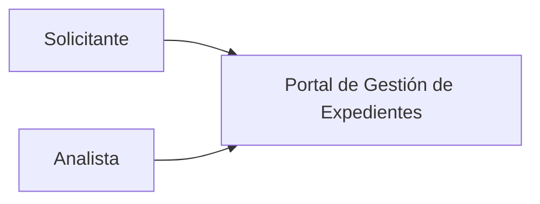
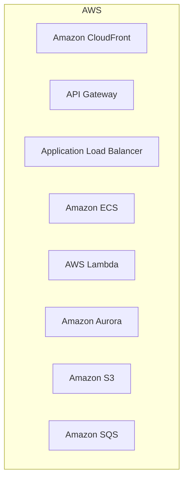

# arc42 — Portal de Gestión de Expedientes

_Generado: 2026-03-26 · Proveedor: aws_

## 1. Introducción y objetivos

### Visión
Digitalizar el ciclo de trámites internos con trazabilidad, firma electrónica y consulta en línea para ciudadanos y analistas.

### Metas
- Reducir tiempo de resolución de trámites en 40%
- Disponibilidad 99.5% en horario laboral
- Auditoría completa de cambios en expedientes

### Stakeholders
- Patrocinador: Dirección de Transformación Digital
- Usuario final: Ciudadano / solicitante
- Operación: Analistas de expedientes

## 2. Restricciones
- Identidad corporativa vía SSO existente (SAML)
- Datos personales sujetos a normativa nacional de protección de datos
- Presupuesto operativo con optimización de costos en entornos no productivos
- RPO 1 hora y RTO 4 horas para datos transaccionales

## 3. Contexto y alcance

### Actores
- Solicitante
- Analista

### Sistemas externos
- IdP corporativo SAML
- Sistema legacy de archivo

### Relaciones
- Solicitante usa el portal para crear y seguir expedientes
- Analista usa el portal para dictamen y firma
- Portal federación con IdP SAML
- Integración batch con legacy de archivo

## 4. Estrategia de solución
APIs detrás de API Gateway, dominios acotados en servicios con Aurora por dominio de expediente, adjuntos en S3, procesamiento de notificaciones asíncrono con SQS.

- Bounded contexts: expediente, documento, notificación
- Lecturas de estado cacheadas en borde
- Outbox para auditoría

## 5. Vista de bloques (C4 contenedores)

### Portal web
- **Responsabilidad:** UI para solicitante y analista
- **Tecnología:** SPA + CDN

### API de expedientes
- **Responsabilidad:** CRUD y flujo de estados del expediente
- **Tecnología:** Contenedores en ECS

### API de documentos
- **Responsabilidad:** Metadatos y enlaces a objetos en S3
- **Tecnología:** Lambda

### Worker de notificaciones
- **Responsabilidad:** Envío de correos y webhooks desde cola
- **Tecnología:** Lambda + SQS

## 6. Vista de ejecución

### Presentación de trámite
Solicitante autenticado → API Gateway → API expedientes → Aurora; adjuntos → API documentos → S3; evento → cola → worker.

## 7. Vista de despliegue

VPC multi-AZ, subnets públicas para ALB, privadas para ECS y Aurora. CloudFront para estáticos.

Secrets en Secrets Manager; logs centralizados en CloudWatch.

## 8. Conceptos transversales
- Logging estructurado con correlation-id
- Autorización por rol (solicitante vs analista)
- Idempotencia en comandos de dictamen

## 9. Decisiones de arquitectura

### ADR-001 — Aurora PostgreSQL como store transaccional

- **Estado:** aceptada
- **Contexto:** RPO 1h, consultas relacionales y transacciones ACID
- **Decisión:** Aurora PostgreSQL multi-AZ con réplica lectura para reportes livianos
- **Consecuencias:** Costo administrado mayor que self-hosted; backups automáticos

### ADR-002 — Transactional Outbox para auditoría

- **Estado:** aceptada
- **Contexto:** Auditoría debe ser consistente con commit de negocio
- **Decisión:** Tabla outbox en mismo schema + publicador asíncrono
- **Consecuencias:** Latencia eventual en auditoría < 30 s

## 10. Requisitos de calidad

### Consulta de estado en pico
- **Estímulo:** 500 usuarios concurrentes consultan estado tras notificación masiva
- **Respuesta:** Página de estado en menos de 2 s p95
- **Medida:** Latencia p95 < 2 s, error rate < 0.1%

### Registro de dictamen
- **Estímulo:** Analista registra dictamen con adjuntos hasta 25 MB
- **Respuesta:** Confirmación transaccional y evento de auditoría
- **Medida:** Commit en < 5 s; evento audit en < 30 s

## 11. Riesgos y deuda técnica

- **Pruebas de DR incompletas** (alta): Backups configurados pero restauración no probada en los últimos 12 meses (control: REL-02)

## 12. Glosario
- Expediente: carpeta digital con estados y documentos
- Dictamen: resolución formal del analista

---

## Anexo: Servicios de nube

- Amazon CloudFront (red)
- API Gateway (integracion)
- Application Load Balancer (red)
- Amazon ECS (compute)
- AWS Lambda (compute)
- Amazon Aurora (datos)
- Amazon S3 (datos)
- Amazon SQS (integracion)
- Amazon Cognito (identidad)
- Secrets Manager (seguridad)
- AWS KMS (seguridad)
- Amazon CloudWatch (observabilidad)
- AWS X-Ray (observabilidad)
- AWS WAF (seguridad)
- Amazon VPC (red)

## Anexo: Patrones y antipatrones

### Patrones
- **API Gateway** [adoptado]: Punto único de autenticación y limitación
- **Transactional Outbox** [adoptado]: Auditoría consistente con transacción
- **Cola para nivelar carga** [adoptado]: Notificaciones desacopladas de picos

### Antipatrones
- **Base de datos compartida entre servicios** [mitigado]: Schema por servicio en Aurora; sin acceso cruzado directo
- **DR solo documentado** [abierto]: Programar game day trimestral

## Anexo: Evaluación Well-Architected (aws)

**Resumen:** cumple 19, parcial 4, brecha 1, no aplica 0

#### excelencia-operacional
- **OPS-01** (cumple): ¿Los cambios de infraestructura están versionados y automatizados? — Evidencia: CDK en repo con pipeline
- **OPS-02** (parcial): ¿Existen alarmas y runbooks para incidentes frecuentes? — Evidencia: Alarmas en CloudWatch — Brecha: Runbooks incompletos para cola atascada
- **OPS-03** (cumple): ¿Hay estrategia de despliegue con reversión? — Evidencia: Blue/green en ECS
- **OPS-04** (cumple): ¿La observabilidad cubre métricas, logs y trazas del camino crítico? — Evidencia: X-Ray en API expedientes

#### seguridad
- **SEC-01** (cumple): ¿Identidad y acceso siguen mínimo privilegio? — Evidencia: IAM roles por tarea ECS
- **SEC-02** (cumple): ¿Datos sensibles cifrados en tránsito y reposo? — Evidencia: TLS + KMS en Aurora y S3
- **SEC-03** (cumple): ¿Secretos fuera del código y con rotación? — Evidencia: Secrets Manager
- **SEC-04** (cumple): ¿Hay protección en perímetro (WAF) y segmentación de red? — Evidencia: WAF en CloudFront

#### fiabilidad
- **REL-01** (cumple): ¿La arquitectura tolera falla de una AZ? — Evidencia: Multi-AZ Aurora y ECS
- **REL-02** (brecha): ¿Backups y RPO están definidos y probados? — Evidencia: Snapshots diarios — Brecha: Restauración no probada
- **REL-03** (cumple): ¿Cuotas y límites de servicio revisados? — Evidencia: Service Quotas revisadas
- **REL-04** (cumple): ¿Dependencias críticas tienen timeout, reintento e idempotencia? — Evidencia: Idempotencia en dictamen

#### eficiencia-rendimiento
- **PERF-01** (cumple): ¿El cómputo y almacenamiento coinciden con el perfil de carga? — Evidencia: Lambda para docs, ECS para API
- **PERF-02** (cumple): ¿Hay caché o CDN donde reduzca latencia? — Evidencia: CloudFront
- **PERF-03** (cumple): ¿Procesos pesados están desacoplados asíncronamente? — Evidencia: SQS notificaciones
- **PERF-04** (parcial): ¿Existen pruebas de carga sobre escenarios de calidad? — Evidencia: Prueba piloto — Brecha: Falta escenario pico 500 usuarios

#### optimizacion-costos
- **COST-01** (cumple): ¿Recursos etiquetados para asignación de costos? — Evidencia: Tags por entorno
- **COST-02** (cumple): ¿Se evita capacidad fija para cargas intermitentes? — Evidencia: Lambda workers
- **COST-03** (parcial): ¿Hay revisión periódica de recursos ociosos? — Evidencia: Revisión mensual
- **COST-04** (cumple): ¿Entornos no productivos se apagan o reducen fuera de horario? — Evidencia: dev/qa apagados noches

#### sostenibilidad
- **SUS-01** (cumple): ¿La arquitectura evita sobreaprovisionamiento continuo? — Evidencia: Autoescalado ECS
- **SUS-02** (cumple): ¿El escalado sigue la demanda real? — Evidencia: Políticas por CPU
- **SUS-03** (cumple): ¿Se priorizan servicios administrados sobre VMs siempre encendidas? — Evidencia: Aurora y Lambda
- **SUS-04** (parcial): ¿Datos y retención alineados a necesidad (menos almacenamiento innecesario)? — Evidencia: Lifecycle en S3 — Brecha: Retención logs por revisar

## Anexo: Buenas prácticas de mercado (referencia)

#### excelencia-operacional
- Infraestructura como código (CloudFormation/CDK/Terraform) con revisiones
- Runbooks y alarmas accionables en CloudWatch
- Despliegues automatizados con rollback
#### seguridad
- Principio de mínimo privilegio en IAM
- Cifrado en tránsito y reposo por defecto
- Gestión centralizada de secretos
#### fiabilidad
- Multi-AZ para componentes stateful críticos
- Cuotas y límites de servicio revisados antes de producción
- Pruebas de conmutación y chaos controlado
#### eficiencia-rendimiento
- Selección de instancia/compute según perfil de carga
- Caché en el borde (CloudFront) y cerca de datos
- Revisión periódica de latencia y throughput
#### optimizacion-costos
- Etiquetado de costos y budgets
- Rightsizing y planes de ahorro cuando la carga es estable
- Serverless o escalado para cargas intermitentes
#### sostenibilidad
- Regiones y tamaños de recurso alineados a la demanda real
- Arquitecturas sin sobreaprovisionamiento permanente
